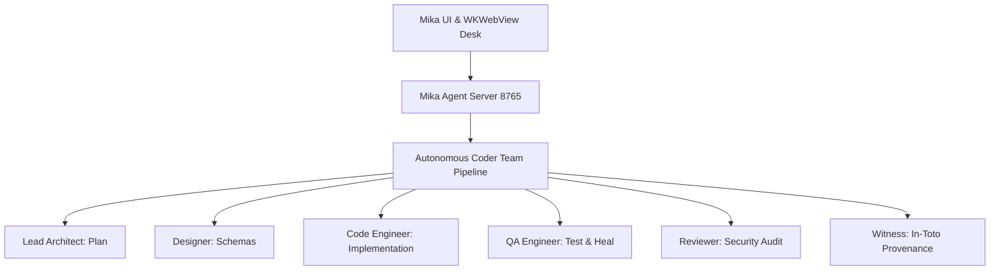

# System Design Specifications
**Project**: Build end-to-end autonomous coding engine
**Engine**: Mika Autonomous Coder Team

## 1. Component Architecture

## 2. Interface Contracts
- **Task API**: `/api/v1/tasks` (Start, Poll, Steer, Cancel)
- **MCP Bridge**: `/api/v1/mcp/*` (Marketplace, Install, Call, Toggle)
- **Coder Team API**: `/api/v1/coder/team` (Full autonomous run)
- **Secret Scope**: Automatic regex scrubbing on all stdout/stderr channels.
