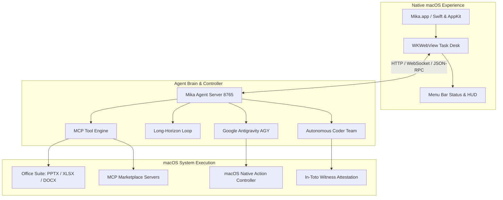

# Mika AGY - Mika Agent for Google Antigravity on Mac/OSX

<div align="center">


### Autonomous macOS Computer Use Agent powered by Google Antigravity (AGY) & Gemini
*End-to-End MCPs · Long-Horizon Loop · Autonomous Coder Team · Native macOS App · In-Toto Witness Attestation*

[](LICENSE)
[](https://github.com/romangalaxys10-spec/mika-agy)
[](https://github.com/wangzan101/Mika)
[](https://github.com/in-toto/witness)

</div>

---

## 🌟 Upstream Attribution & Heritage

> **Note**: **Mika AGY** is a specialized fork of the open-source project [**wangzan101/mika**](https://github.com/wangzan101/Mika). While original Mika focused on mobile Android automation over ADB, **Mika AGY** elevates Mika to a full-fledged **autonomous macOS desktop workstation agent & virtual employee**, powered by **Google Antigravity (AGY)** and native macOS system controls.

---

## 🚀 Key Innovations in Mika AGY

### 1. 🖥️ Native macOS Desktop Control & AppKit Application (`Mika.app`)
- **Native Swift Architecture**: Built with AppKit, WKWebView, and `UserNotifications`.
- **System-wide Computer Use**: Native AppleScript, CGEvent mouse/keyboard dispatch, Terminal automation, Finder control, and window management.
- **Menu Bar & Global Shortcut**: Access Mika instantly from the macOS status bar (`⌘⇧M`) or floating HUD.

### 2. 🧩 End-to-End Model Context Protocol (MCP) Hub
- **Curated Marketplace**: 1-click install for `filesystem`, `brave-search`, `fetch`, `github`, `sqlite`, `puppeteer`, `memory`, and `mac-office-suite`.
- **Manual Installation**: Install any MCP server from Git URLs, NPM (`npx`), PyPI (`uvx`), or custom commands with environment variables.
- **Persistent Registry**: Manages configurations in `~/.mika/mcp_servers.json` with JSON-RPC 2.0 tool execution.

### 3. ⚡ Long-Horizon Autonomous Delivery Loop
- **Multi-Step Milestone Planner**: Cloned and inspired by [HKUDS/AutoAgent](https://github.com/HKUDS/AutoAgent) and [openclaw/openclaw](https://github.com/openclaw/openclaw).
- **Repetition Guard**: Detects cyclical loops and breaks deadlocks.
- **Secret Scope (Hermes-Agent)**: Real-time redaction of API keys, GitHub PATs (`ghp_...`), and sensitive tokens to guarantee **zero secret leakage**.
- **Self-Refine & Verification**: Continuous evaluation against ground-truth acceptance criteria before marking tasks completed.

### 4. 💻 Autonomous "Coder" Team Mode
- Reusing multi-agent architectures from [zai-org/ZCode](https://github.com/zai-org/ZCode), [getpaseo/paseo](https://github.com/getpaseo/paseo), and [anywhere-labs/dsh-desktop](https://github.com/anywhere-labs/dsh-desktop):
  - **Lead Software Architect**: Requirements breakdown, module boundaries, `PLAN.md`.
  - **System Designer**: Interface specifications, data models, `DESIGN.md`.
  - **Senior Code Engineer**: Idiomatic code implementation and atomic file creation.
  - **QA Automation Specialist**: Automated test execution and self-healing bug patches.
  - **Security Reviewer**: Anti-slop audit, strict type hygiene, `CODE_REVIEW.md`.
  - **Release Manager**: In-toto cryptographic provenance attestation via `witness`.

### 5. 🏢 Full-Scale Employee Deliverables Suite
- **PowerPoint Presentations**: Generates complete 16:9 `.pptx` decks and interactive modern HTML5 presentations.
- **Excel Financial Models**: Produces multi-tab `.xlsx` workbooks with formulas, unit economics, and margins.
- **Executive Word Proposals**: Formats polished `.docx` proposals and contract outlines.
- **Desktop Project Workspaces**: Auto-organizes clean folder hierarchies on the macOS Desktop.

### 6. 🛡️ Resilient Auto-Healing Architecture
- Completely eliminates `"Cannot reach the local desk"` errors through loopback host/origin normalization and WKWebView session resilience.
- Native Swift watchdog process automatically monitors and restarts backend services upon unexpected exits.

---

## 📦 Architecture Overview



---

## 🛠️ Quick Start

### Prerequisites
- macOS 12.0+ (Apple Silicon M1/M2/M3/M4 recommended)
- Python 3.10+
- Optional: `npx` (Node.js) / `uvx` (uv) for MCP Marketplace servers

### 1. Build and Install Native App
```bash
git clone https://github.com/romangalaxys10-spec/mika-agy.git
cd mika-agy/mac-app
bash build_app.sh
bash install.sh
```

### 2. Launching Mika
- Open `/Applications/Mika.app` from Finder or Spotlight.
- Or start the headless agent server:
```bash
python3 agent-server/mika_agent_server.py --port 8765
```

---

## 🔒 Security & Supply Chain Attestation

Mika AGY adheres to strict enterprise software supply chain security standards:
- **Zero Secret Leakage Guarantee**: Protected by `SecretScope` filter matching tokens, private keys, and passwords across all input/output channels.
- **In-Toto Witness**: Cryptographic build attestation using [in-toto/witness](https://github.com/in-toto/witness) (`attestation.json`).

---

## 📄 License & Credits

- Licensed under the **Apache License 2.0**.
- Original Mika project by [wangzan101](https://github.com/wangzan101/Mika).
- AGY integration, Coder Team, and macOS Native Workstation architecture by the Antigravity community.
